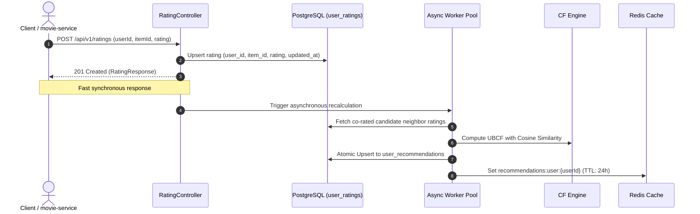

# Recommendation Service

A high-performance, domain-agnostic recommendation microservice built with **Spring Boot**, **PostgreSQL**, and **Redis**. It provides personalized recommendations using **User-Based Collaborative Filtering (UBCF)** with Cosine Similarity, strict exclusion of already-rated items, dual-store persistence for fault tolerance, and a configurable fallback policy.

---

## 🌟 Key Features

* **Generic & Domain-Agnostic:** Operates strictly on abstractions (`userId`, `itemId`, `rating`). Integrates seamlessly with `movie-service`, `book-service`, `product-service`, or any domain catalog without needing item metadata.
* **Precise Rating Scale:** Supports a 5-point rating scale with up to 2 decimal places (e.g., `3.75`, `4.50`, `1.00`, range `0.00` to `5.00`).
* **Strict Exclusion Guarantee:** Items already rated by a user are strictly filtered out and never recommended back to them.
* **Dual-Store Architecture (Redis + PostgreSQL):** 
  * Recommendations are cached in **Redis** for sub-millisecond retrieval (`<2ms`).
  * Persisted in **PostgreSQL** permanent store to eliminate data loss during cache evictions or Redis downtime.
* **Resilient Cache Layer:** If Redis goes down, the service gracefully falls back to on-demand recalculation and PostgreSQL without throwing 500 errors.
* **Asynchronous Rating Engine:** When a rating is posted (`POST /api/v1/ratings`), it acknowledges immediately (`201 Created`) and recalculates recommendations asynchronously in the background.
* **Configurable Fallback Policy:**
  * **Default = NO (`false`):** Returns an empty list (`[]`) if the user has no recommendations.
  * **When YES (`true`):** Returns global top-rated/popular items, still filtering out items already rated by the user.
* **Daily Scheduled Job:** Automatically recalculates and refreshes global fallback recommendations once a day at midnight.

---

## 🏗️ Architecture & Flow

### 1. Recommendation Retrieval Flow (`GET /api/v1/recommendations/{userId}`)

```mermaid
flowchart TD
    Start([User calls GET /recommendations/userId]) --> RedisCheck{Redis Cache Hit?}
    
    %% Hit
    RedisCheck -->|HIT| ReturnRedis([Return Cached Item IDs])
    
    %% Miss / Down
    RedisCheck -->|MISS or Redis Down| Recalc[Recalculate on-demand via CF Engine]
    
    Recalc --> CheckCount{Calculated Items > 0?}
    
    %% > 0 items
    CheckCount -->|YES| ReturnCalculated([Return Recommended Item IDs])
    ReturnCalculated -.->|Asynchronously| AsyncSave[Atomic Upsert to PostgreSQL & Redis with TTL]
    
    %% 0 items
    CheckCount -->|NO: 0 items| CheckPolicy{Fallback Policy Enabled?}
    
    %% Fallback NO
    CheckPolicy -->|fallback = NO / default| ReturnEmpty([Return Empty List []])
    
    %% Fallback YES
    CheckPolicy -->|fallback = YES| TryRedisFallback{Redis Fallback Hit?}
    TryRedisFallback -->|HIT| ExcludeRated1[Filter out items rated by user]
    TryRedisFallback -->|MISS or Redis Down| FetchDBFallback[Fetch Fallback from PostgreSQL]
    FetchDBFallback --> ExcludeRated2[Filter out items rated by user]
    ExcludeRated1 --> ReturnFallback([Return Fallback Items])
    ExcludeRated2 --> ReturnFallback
```

### 2. Rating Submission Flow (`POST /api/v1/ratings`)



---

## 🧮 Collaborative Filtering Algorithm

The service implements **User-Based Collaborative Filtering (UBCF)**:

### 1. Candidate Neighbor Selection
Only users who have rated at least one item in common with the active user $u$ are retrieved from PostgreSQL:
```sql
SELECT r FROM UserRating r WHERE r.userId IN (
    SELECT DISTINCT r2.userId FROM UserRating r2 WHERE r2.itemId IN (
        SELECT r1.itemId FROM UserRating r1 WHERE r1.userId = :userId
    )
);
```

### 2. User Similarity (Cosine Metric)
Cosine similarity between active user $u$ and neighbor $v$ over their co-rated items $I_{uv}$:
$$\text{sim}(u, v) = \frac{\sum_{i \in I_{uv}} r_{u,i} \cdot r_{v,i}}{\sqrt{\sum_{i \in I_{uv}} r_{u,i}^2} \cdot \sqrt{\sum_{i \in I_{uv}} r_{v,i}^2}}$$

### 3. Top-$K$ Neighbor Pruning
Neighbors with $\text{sim}(u, v) \le 0$ are discarded, and the top-$K$ most similar users (default $K = 20$) are retained.

### 4. Score Prediction & Ranking
For each candidate unrated item $j \notin \text{Rated}(u)$ rated by at least one neighbor:
$$\hat{r}_{u,j} = \frac{\sum_{v \in K} \text{sim}(u, v) \cdot r_{v,j}}{\sum_{v \in K} \text{sim}(u, v)}$$
Candidates are sorted descending by predicted rating, and the top-$N$ (`limit`) item IDs are returned.

---

## 📡 REST API Reference

### 1. Submit or Update a Rating
Records a new rating or updates an existing rating for a user and item.

* **Endpoint:** `POST /api/v1/ratings`
* **Content-Type:** `application/json`

#### Request Body
```json
{
  "userId": "d8142340-9a29-45bc-8a71-123456789abc",
  "itemId": "movie-101",
  "rating": 3.75
}
```

| Field | Type | Validation | Description |
|---|---|---|---|
| `userId` | `String` | Required, non-blank | Unique identifier of the user (e.g. UUID) |
| `itemId` | `String` | Required, non-blank | Unique identifier of the item (e.g. movieId) |
| `rating` | `BigDecimal` | Required, `0.00` to `5.00`, max 2 decimals | User rating value |

#### Response (`201 Created`)
```json
{
  "id": 1,
  "userId": "d8142340-9a29-45bc-8a71-123456789abc",
  "itemId": "movie-101",
  "rating": 3.75,
  "updatedAt": "2026-10-26T11:00:00Z"
}
```

---

### 2. Get User Recommendations
Retrieves a personalized list of recommended item IDs for the user.

* **Endpoint:** `GET /api/v1/recommendations/{userId}`
* **Query Parameters:**
  * `limit` *(Optional, default: 10)*: Maximum number of item IDs to return.

#### Response (`200 OK`)
```json
{
  "userId": "d8142340-9a29-45bc-8a71-123456789abc",
  "itemIds": [
    "movie-204",
    "movie-305",
    "movie-401"
  ],
  "count": 3,
  "source": "REDIS_CACHE_HIT"
}
```

#### Possible `source` values in response:
* `REDIS_CACHE_HIT`: Retrieved from Redis cache.
* `RECALCULATED`: Computed on-demand via Collaborative Filtering.
* `FALLBACK`: Recalculation returned 0 items; returned global fallback recommendations.
* `EMPTY`: Recalculation returned 0 items and fallback policy is disabled.

---

## ⚙️ Configuration Properties

Configured in `src/main/resources/application.properties`:

```properties
# PostgreSQL Database
spring.datasource.url=jdbc:postgresql://localhost:5432/recommendationServiceDB
spring.datasource.username=postgres
spring.datasource.password=password

# Redis Cache
spring.data.redis.host=localhost
spring.data.redis.port=6379
spring.data.redis.timeout=2000ms

# Collaborative Filtering Engine Settings
recommendation.engine.top-n=10
recommendation.engine.neighbor-k=20
recommendation.cache.ttl-hours=24

# Fallback Policy
# Default is false (NO fallback: returns empty list)
recommendation.fallback.enabled=false
recommendation.fallback.cron=0 0 0 * * *
recommendation.fallback.limit=20
```

---

## 🗄️ Database Schema

The service creates three tables in PostgreSQL:

1. **`user_ratings`**: Stores all user interactions with a unique constraint on `(user_id, item_id)` and indexes for fast candidate neighbor lookups.
2. **`user_recommendations`**: Permanent store for precomputed recommendations per user (JSON array in `TEXT` column).
3. **`fallback_recommendations`**: Permanent store for global fallback recommendations (JSON array in `TEXT` column).

---

## 🚀 Getting Started

### Prerequisites
* Java 21 JDK
* PostgreSQL 14+ (or Docker container running on port `5432`)
* Redis 6+ (or Docker container running on port `6379`)

### 1. Database & Redis Setup via Docker
If not already running, you can start PostgreSQL and Redis using Docker:

```bash
# Start PostgreSQL
docker run -d --name recservice-postgres -p 5432:5432 \
  -e POSTGRES_DB=recommendationServiceDB \
  -e POSTGRES_USER=postgres \
  -e POSTGRES_PASSWORD=password \
  postgres:17

# Start Redis
docker run -d --name recservice-redis -p 6379:6379 redis:7-alpine
```

### 2. Build and Test
Run the full unit and integration test suite:

```bash
./mvnw clean test
```

### 3. Run the Service
```bash
./mvnw spring-boot:run
```
The microservice will start on port `8080`.

---

## 🧪 Testing with cURL

```bash
# 1. Submit a rating
curl -X POST http://localhost:8080/api/v1/ratings \
  -H "Content-Type: application/json" \
  -d '{
    "userId": "user-123",
    "itemId": "movie-456",
    "rating": 4.25
  }'

# 2. Get recommendations
curl -X GET "http://localhost:8080/api/v1/recommendations/user-123?limit=5"
```
